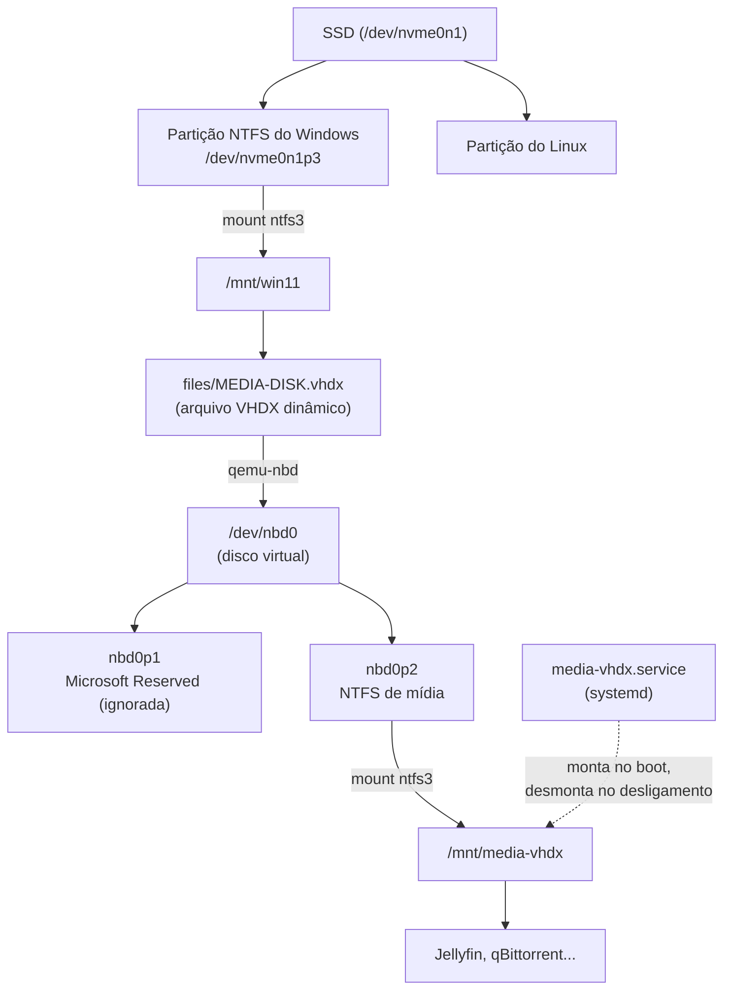

# vhdx-win11-oma

Um disco de mídia compartilhado entre **Windows 11** e **Linux** (testado no
[Omarchy](https://omarchy.org)) em dual boot, usando um arquivo **VHDX** que
fica dentro da partição do Windows.

No Windows, o VHDX é anexado como um disco comum (por exemplo `M:`). No Linux,
o script `mount-media-vhdx` monta a partição do Windows, conecta o VHDX com
`qemu-nbd` e monta o disco de dentro dele em `/mnt/media-vhdx`, com leitura e
escrita para o seu usuário. Serve bem para Jellyfin, qBittorrent ou qualquer
biblioteca que você queira acessar dos dois sistemas.

## Como funciona



Por que um VHDX em vez de uma partição separada? Ele cresce sob demanda (só
ocupa o que tem dentro), não exige reparticionar o SSD e o Windows monta
nativamente.

O kernel do Linux não lê VHDX diretamente. Quem faz a tradução é o `qemu-nbd`,
que expõe o conteúdo do arquivo como um disco de bloco (`/dev/nbd0`). Por isso
tanto faz o VHDX ser GPT ou MBR: o script procura a partição NTFS dentro dele e
ignora o resto.

## Requisitos

- Dual boot Windows 11 + Linux com systemd.
- Kernel com os módulos `nbd` e `ntfs3` (o padrão no Arch/Omarchy).
- `qemu-nbd` (pacote `qemu-img` no Arch: `sudo pacman -S qemu-img`).
- `util-linux` (`partx`, `blkid`, `findmnt`, `flock`), já presente em quase
  toda distro.

## 1. Criar o VHDX no Windows

Em **Gerenciamento de Disco** → **Ação** → **Criar VHD**:

1. Local: por exemplo `C:\files\MEDIA-DISK.vhdx`.
2. Formato **VHDX**, tipo **Expansão dinâmica**, com o tamanho máximo que
   quiser.
3. Inicialize o disco novo (GPT ou MBR, tanto faz), crie um volume **NTFS** e
   dê uma letra a ele.

Importante: **desative a Inicialização Rápida** do Windows (Painel de Controle
→ Opções de Energia → "Escolher a função dos botões de energia") e não use
hibernação. Com elas, o Windows deixa o NTFS marcado como "em uso" e o Linux
não consegue montar com escrita. O script avisa quando isso acontece.

## 2. Instalar no Linux

```bash
git clone <url-deste-repo> vhdx-win11-oma
cd vhdx-win11-oma
./install.sh
```

O instalador copia o script para `/usr/local/bin/mount-media-vhdx`, cria
`/etc/media-vhdx.conf` (se ainda não existir) e instala o serviço
`media-vhdx.service`.

Depois **revise `/etc/media-vhdx.conf`**. O principal é apontar para a sua
partição do Windows e para o caminho do VHDX:

```bash
lsblk -f                      # a partição do Windows é a NTFS grande, com label "OS"
ls -l /dev/disk/by-uuid/      # UUID dela, que é mais estável que /dev/nvme0n1pX
```

```bash
# /etc/media-vhdx.conf
WIN_PART="/dev/disk/by-uuid/SEU-UUID-AQUI"
VHDX_PATH="files/MEDIA-DISK.vhdx"   # C:\files\MEDIA-DISK.vhdx
```

Se mudar `WIN_MNT` ou `MEDIA_MNT`, rode `./install.sh` de novo para o serviço
acompanhar.

## 3. Usar

```bash
mount-media-vhdx            # monta tudo
mount-media-vhdx --umount   # desmonta tudo
```

O script pede `sudo` sozinho e passa pelo serviço systemd. Assim, se você
esquecer de desmontar, o systemd desmonta com segurança no desligamento. Isso
importa: o `qemu-nbd` guarda escritas em cache, e desligar com o VHDX conectado
pode corrompê-lo.

Para montar automaticamente a cada boot:

```bash
sudo systemctl enable media-vhdx
```

Se o Windows estiver hibernado, a montagem no boot falha sem travar o sistema.
O motivo aparece em `journalctl -u media-vhdx -b`.

### Serviços que dependem do disco

Para um serviço como o Jellyfin só subir depois do disco montado, crie um
override com `sudo systemctl edit jellyfin`:

```ini
[Unit]
Requires=media-vhdx.service
After=media-vhdx.service
```

## O que o script verifica

- Monta a partição do Windows e o disco do VHDX com escrita e **confere** que
  ficaram mesmo com escrita. Se não, desfaz tudo e explica a causa provável.
- Carrega o `nbd` com suporte a partições (`max_part=8`). Sem isso, o
  `qemu-nbd` conecta, mas nenhuma partição aparece.
- Encontra sozinho a partição NTFS dentro do VHDX (num VHDX GPT criado pelo
  Windows existe também a partição "Microsoft Reserved").
- Se algo falhar no meio, desfaz só o que aquela execução montou.
- Usa uma trava (`flock`) para impedir duas execuções ao mesmo tempo.
- Recusa desmontar coisas que não foram montadas por ele.

## Solução de problemas

| Sintoma | Causa provável | O que fazer |
|---|---|---|
| "ficou somente leitura" ou falha ao montar `/mnt/win11` | Windows hibernado ou com Inicialização Rápida | No Windows, desligue com `shutdown /s /t 0` |
| "o NTFS dentro do VHDX ficou somente leitura" | VHDX não foi desanexado direito no Windows | No Windows, anexe o VHDX, rode `chkdsk /f M:` e desanexe |
| "max_part=0" | Módulo `nbd` carregado antes sem suporte a partições | `sudo modprobe -r nbd` e rode o script de novo |
| "está em uso" ao desmontar | Algum programa com arquivos abertos no disco | O script lista os processos; feche-os e tente de novo |
| Falha no boot | Qualquer um dos acima | `journalctl -u media-vhdx -b` |

## Desinstalar

```bash
./install.sh --uninstall
```

Remove o script e o serviço. A configuração em `/etc/media-vhdx.conf` é
mantida; apague-a à mão se quiser.

## Licença

[MIT](LICENSE)
